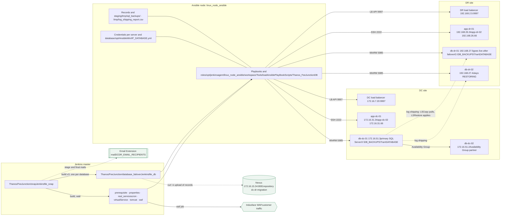
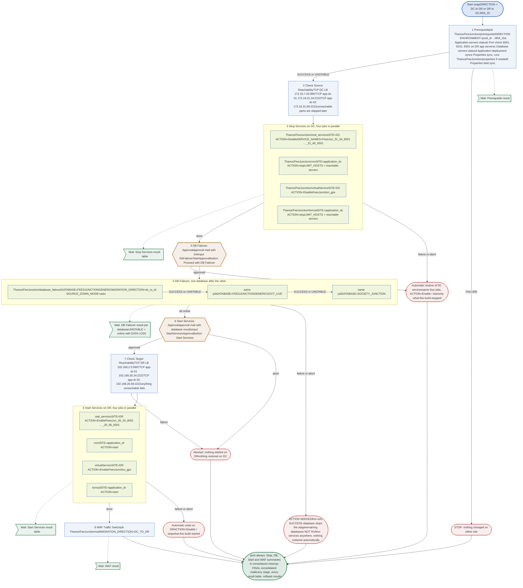
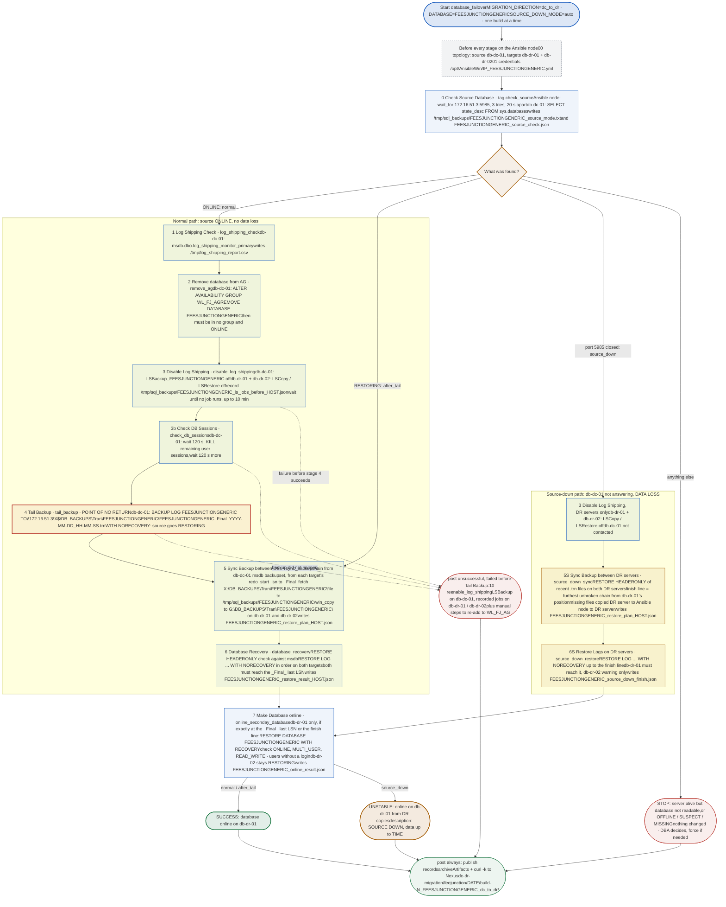
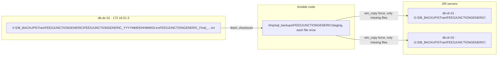
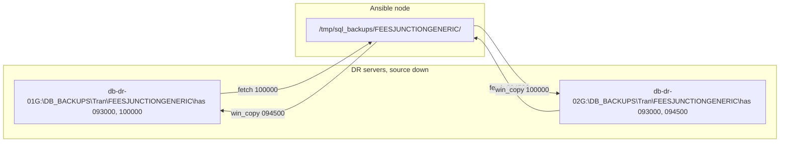
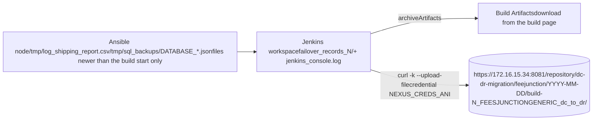

Thanos / FeeJunction · one-click DC/DR failover

# FeeJunction DC/DR Failover Flow

How the snap pipeline and the database failover pipeline run end to end: every stage, approval, mail, server, database, Availability Group, file and Nexus upload. Shown for DC to DR; the DR to DC differences are in section 8.

[1 Landscape](#landscape) [2 Snap pipeline](#snap) [3 Database pipeline](#db) [4 Log backup movement](#files) [5 Files and locations](#records) [6 Mails](#mail) [7 Nexus](#nexus) [8 DR to DC](#reverse) [9 Rollback rules](#rollback)

1

## Landscape

Jenkins runs on the master node; every Ansible run happens on the Linux agent `linux_node_ansible`, which reaches the Windows database servers over Windows Remote Management (port 5985, NTLM) and the Linux application servers over SSH (port 2222).

| Server | Address | Role in DC to DR |
| --- | --- | --- |
| db-dc-01 | 172.16.51.3 | Source SQL Server (first host of `[database_dc]`); backups in `X:\DB_BACKUPS\Tran\DATABASE`, share `\\172.16.51.3\X$\...` |
| db-dc-02 | 172.16.51.2 | Availability Group partner of db-dc-01; not touched |
| db-dr-01 | 192.168.27.5 | Target, brought ONLINE (first host of `[database_dr]`); `G:\DB_BACKUPS\Tran\DATABASE` |
| db-dr-02 | 192.168.27.4 | Target, restored to the same point, stays RESTORING |
| app-dc-01 / app-dc-02 | 172.16.31.34 / .66 | Source application servers (SSH 2222); app-dc-02 runs pod 3 (8301) |
| app-dr-01 / app-dr-02 | 192.168.26.34 / .66 | Target application servers; app-dr-02 runs pod 3 (8301) |
| DC load balancer | 172.16.7.20:9997 | Real services `FeesJun_31_34_8001`, `_31_34_8101`, `_31_66_8001`, `_31_66_8101`, `_31_66_8301`; virtual service `FeesJunction_gpx` |
| DR load balancer | 192.168.2.5:9997 | Real services `FeesJun_26_34_8001`, `_26_34_8101`, `_26_66_8001`, `_26_66_8101`, `_26_66_8301`; virtual service `FeesJunction_gpx` |
| Ansible node | linux_node_ansible | Runs every playbook; holds credentials, staging and records |
| Nexus | 172.16.15.34:8081 | Raw repository `dc-dr-migration`, credential `NEXUS_CREDS_ANI` |

| Database | Availability Group (DC) | Failover order |
| --- | --- | --- |
| FEESJUNCTIONGENERIC | `WL_FJ_AG` | 1st |
| FEESJUNCTIONGENERICGOVT_LIVE | `WL_FJGOVT_AG` | 2nd |
| SOCIETY_JUNCTION | `WL_SJ_AG` | 3rd |

| Log shipping job | Server |
| --- | --- |
| `LSBackup_DATABASE` | db-dc-01 |
| `LSCopy_SOURCESQL_DATABASE` | db-dr-01, db-dr-02 |
| `LSRestore_SOURCESQL_DATABASE` | db-dr-01, db-dr-02 |

| Credentials file (Ansible node) | Used for |
| --- | --- |
| `/opt/AnsibleWin/172.16.51.3_DATABASE.yml` | db-dc-01 |
| `/opt/AnsibleWin/192.168.27.5_DATABASE.yml` | db-dr-01 |
| `/opt/AnsibleWin/192.168.27.4_DATABASE.yml` | db-dr-02 |

SOURCESQL is the `sql_server` value in the source credentials file; DATABASE is the database being failed over.

2

## Snap pipeline: Thanos/FeeJunction/snap

One click runs nine stages in order. Two manual gates stop the build for a person: one before anything touches the databases, one before the target site takes traffic. Stop and Start each run four downstream jobs in parallel.

Stage / downstream job Manual approval Mail sent Stop, rollback or action needed

| Stage | Downstream job and parameters | If it fails or is aborted |
| --- | --- | --- |
| 1 Prerequisite | `Thanos/FeeJunction/prerequisite` · DIRECTION, ENVIRONMENT (`prod_dr` / `prod_dc`), JIRA_ID. May trigger `Thanos/FeeJunction/properties`. | Build stops; nothing changed. UNSTABLE continues as a warning. |
| 2 Check Source Reachability | TCP checks from Jenkins, no job | Unreachable parts are marked SKIPPED in Stop Services |
| 3 Stop Services | `real_services` SITE, ACTION, SERVICE_NAMES · `cron` SITE, ACTION, LIMIT_HOSTS · `virtualService` SITE, ACTION · `tomcat` SITE, ACTION, LIMIT_HOSTS | Restores what this build stopped on the source |
| 4 DB Failover Approval | input `DbFailoverStartApproval`, approver recorded in `DB_APPROVER` | Abort restores the source services |
| 5 DB Failover | `Thanos/FeeJunction/database_failover` × 3 · MIGRATION_DIRECTION (`dc_to_dr`), DATABASE, SOURCE_DOWN_MODE=auto | No automatic restore anywhere; ACTION NEEDED in the mails |
| 6 Start Services Approval | input `StartServicesApproval`, approver recorded in `START_APPROVER` | Abort: nothing started, nothing restored |
| 7 Check Target Reachability | TCP checks from Jenkins, no job | Build fails before anything starts |
| 8 Start Services | Same four jobs on the target, ACTION=Enable / start | Undoes what this build started on the target |
| 9 WAF Traffic Switch | `Thanos/FeeJunction/waf` · MIGRATION_DIRECTION (`DC_TO_DR`) | Nothing undone; check the website in the Indusface portal |

3

## Database pipeline: Thanos/FeeJunction/database_failover

One build fails over one database. Each stage is a separate run of `playbooks/failover_playbooks/db_failover_playbook.yml` with one tag. Stage 0 decides which of three paths the build takes. Shown for FEESJUNCTIONGENERIC (Availability Group `WL_FJ_AG`); the other two databases are identical with their own names.

| Stage 0 found | auto (snap) | never | force | Stages that run |
| --- | --- | --- | --- | --- |
| Database ONLINE | normal | normal | source_down | 1, 2, 3, 3b, 4, 5, 6, 7 |
| Database RESTORING (tail already taken) | after_tail | after_tail | source_down | 5, 6, 7 |
| Port 5985 closed after 3 tries | source_down | stop | source_down | 3 (DR only), 5S, 6S, 7 · build ends UNSTABLE |
| Port open, login or SQL Server fails | stop | stop | source_down | none |
| OFFLINE, SUSPECT, MISSING, other | stop | stop | source_down | none |

4

## How log backup files move

A Windows Remote Management session on a DR server cannot open the DC share with NTLM (the double-hop limit), so every copy goes through the Ansible node: fetched once, copied to each server that needs it, and the staging folder is always deleted afterwards.

Normal path, stage 5. The list comes from db-dc-01 msdb (`backupset` + `backupmediafamily`).

Source-down path, stage 5S. The list comes from `RESTORE HEADERONLY` on each DR server; db-dc-01 is never contacted.

5

## Files and their locations

Every file the two pipelines read or write, for FEESJUNCTIONGENERIC. All records on the Ansible node are archived with the database build and uploaded to Nexus.

| File | Where | Written by | Used by |
| --- | --- | --- | --- |
| `FEESJUNCTIONGENERIC_YYYYMMDDHHMMSS.trn` | db-dc-01 `X:\DB_BACKUPS\Tran\FEESJUNCTIONGENERIC\`; copies on db-dr-01/02 `G:\DB_BACKUPS\Tran\FEESJUNCTIONGENERIC\` | LSBackup job; LSCopy job; stages 5 / 5S | LSRestore; stages 6 / 6S |
| `FEESJUNCTIONGENERIC_Final_YYYY-MM-DD_HH-MM-SS.trn` | db-dc-01 `\\172.16.51.3\X$\DB_BACKUPS\Tran\FEESJUNCTIONGENERIC\` | Stage 4 tail backup | Stages 5, 6, 7 (the finish line) |
| `IP_DATABASE.yml` (3 per database) | Ansible node `/opt/AnsibleWin/` | Set up by hand | Every stage (SQL Server name, Windows user, password) |
| `feejunction.ini` | `Thanos_FeeJunctionDB/inventories/` | Repository | Every playbook (server order decides source and target) |
| `log_shipping_report.csv` | Ansible node `/tmp/` | Stage 1 | Records, Nexus |
| `FEESJUNCTIONGENERIC_source_mode.txt` | Ansible node `/tmp/sql_backups/` | Stage 0 | Jenkins: which stages run (also after Restart from Stage) |
| `FEESJUNCTIONGENERIC_source_check.json` | Ansible node `/tmp/sql_backups/` | Stage 0 | Records, Nexus |
| `FEESJUNCTIONGENERIC_ls_jobs_before_db-dr-01.json`, `..._db-dr-02.json` | Ansible node `/tmp/sql_backups/` | Stage 3 | Undo (step 10): re-enable only these jobs. Deleted after stage 4 or the undo. |
| `FEESJUNCTIONGENERIC/` staging folder | Ansible node `/tmp/sql_backups/` | Stages 5 / 5S | Deleted at the end of the copy, always |
| `FEESJUNCTIONGENERIC_restore_plan_HOST.json` | Ansible node `/tmp/sql_backups/` | Stages 5 / 5S | Records, Nexus |
| `FEESJUNCTIONGENERIC_restore_result_HOST.json` | Ansible node `/tmp/sql_backups/` | Stages 6 / 6S | Records, Nexus |
| `FEESJUNCTIONGENERIC_source_down_finish.json` | Ansible node `/tmp/sql_backups/` | Stage 6S | Stage 7 finish line; Jenkins build description |
| `FEESJUNCTIONGENERIC_online_result.json` | Ansible node `/tmp/sql_backups/` | Stage 7 | Records, Nexus |
| `jenkins_console.log` | Jenkins build | Record step (needs `getLog` script approval) | Nexus |

6

## Mails from snap

Sent with the Email Extension plugin (`emailext`, HTML). Every mail carries the same header table: direction, JIRA, who started it, the snap build link, and the build notes. A mail that cannot be sent is a warning only.

| When | Subject | Body |
| --- | --- | --- |
| After 1 Prerequisite | `[DC/DR DC->DR] Prerequisite: STATUS - snap #N` | Prerequisite job link and result |
| After 3 Stop Services | `... Stop Services: STATUS ...` | Result, action, job, detail for the four stop jobs |
| At 4 DB Failover Approval | `... DB Failover Approval: waiting for approval ...` | Open the approval button, Stop Services table |
| After 5 DB Failover | `... DB Failover: STATUS ...` | Approver, one row per database; DATA LOSS note when UNSTABLE; ACTION NEEDED on failure |
| At 6 Start Services Approval | `... Start Services Approval: waiting for approval ...` | Open the approval button, database results |
| After 8 Start Services | `... Start Services: STATUS ...` | Result table for the four start jobs |
| After 9 WAF Traffic Switch | `... WAF Traffic Switch: STATUS ...` | WAF job row; "customer traffic now goes to DR" |
| End of every build (post cleanup) | `[DC/DR DC->DR] Final summary: RESULT - snap #N` | Stage table with time into build, both approvers, Stop / Database / Start / WAF tables, automatic restore and undo tables, ACTION NEEDED notes |

### Recipients (DCDR_EMAIL_RECIPIENTS, same list as the deploy pipeline)

pgmonitoring@worldline.com · dl-applicationteam.ind@worldline.com · aniruddha.patil.external@worldline.com · vaishnavi.mahalle@worldline.com · shubham.pancham@worldline.com · sachin.gorad.external@worldline.com · mahadeer.h.external@worldline.com · vikas.yadav@worldline.com · kumara.dussa@worldline.com · sunil.sahu@worldline.com · nishesh.shukla@worldline.com

7

## Nexus records

After every database build, whatever its result, Jenkins copies the record files written during that build from the Ansible node, archives them as Build Artifacts, and uploads each one. An upload failure is a warning; the artifacts stay on the build.

8

## DR to DC: what changes

The flow is the same; source and target swap.

| Item | DC to DR | DR to DC |
| --- | --- | --- |
| Source database server | db-dc-01 172.16.51.3, `X:\DB_BACKUPS\Tran` | db-dr-01 192.168.27.5, `G:\DB_BACKUPS\Tran` |
| Targets (online / restoring) | db-dr-01 / db-dr-02, `G:\` | db-dc-01 / db-dc-02, `X:\` |
| Snap DIRECTION / database job / WAF job | `DC->DR` / `dc_to_dr` / `DC_TO_DR` | `DR->DC` / `dr_to_dc` / `DR_TO_DC` |
| Prerequisite ENVIRONMENT, port check site | `prod_dr`, DR app servers | `prod_dc`, DC app servers |
| Stopped / started site | Stop DC (172.16.7.20, application_dc), start DR (192.168.2.5, application_dr) | Stop DR, start DC |

9

## Rollback rules

| Where it stops | Source services | Databases | Target services |
| --- | --- | --- | --- |
| Prerequisite fails | Untouched | Untouched | Untouched |
| Stop Services fails or is aborted | restored automatically | Untouched | Untouched |
| DB Failover Approval aborted | restored automatically | Untouched | Untouched |
| Database job fails before Tail Backup | not restored: decide by hand | Log shipping re-enabled automatically; source still ONLINE; re-add to the Availability Group by hand | Untouched |
| Database job fails after Tail Backup | not restored | No copy online anywhere: finish with Restart from Stage, or `RESTORE DATABASE ... WITH RECOVERY` on the source | Untouched |
| Source-down database stage fails | Source is down | No copy online; Restart from Stage 5S, 6S or 7 | Untouched |
| Start Services Approval aborted | not restored | Online on the target | Not started |
| Start Services fails or is aborted | Stopped | Online on the target | undone automatically |
| WAF switch fails | Stopped | Online on the target | Running; nothing undone, check the WAF by hand |

After a source-down failover the old source must not take traffic again if it comes back: it may hold transactions the new primary does not have.